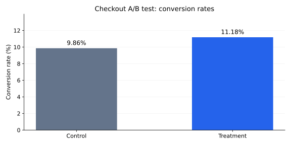
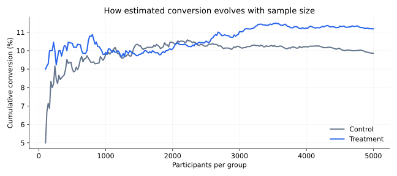
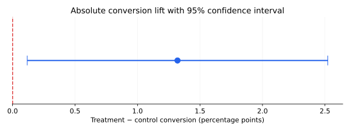

# Python A/B Testing & Experiment Analytics

An end-to-end, reproducible e-commerce experimentation project. It demonstrates how to design an experiment, validate randomization, estimate conversion lift, quantify uncertainty, and make a statistically defensible rollout decision.

## What it includes

- **Reproducible synthetic data:** user-level randomized checkout experiment with conversion and revenue.
- **Experiment diagnostics:** sample-ratio mismatch (SRM) check and data validation.
- **Frequentist analysis:** two-proportion z-test, 95% confidence interval for absolute conversion lift, relative lift, and an effect-size estimate.
- **Planning:** required sample size per group using baseline conversion, minimum detectable effect (MDE), power, and significance level.
- **Revenue guardrail:** revenue per visitor, with a bootstrap confidence interval.
- **Interactive dashboard:** Streamlit metrics, charts, and configurable experiment assumptions.
- **GitHub-viewable chart gallery:** committed SVG charts in [`visualizations/`](visualizations/) that require no installation.
- **CLI and automated tests:** repeatable outputs and GitHub Actions CI.

> **Data disclaimer:** All example data is simulated. Any result shown by this repository is illustrative, not evidence of a real-world product improvement.

## Quick start

Python 3.10+ recommended.

```bash
python -m venv .venv
source .venv/bin/activate  # Windows: .venv\Scripts\activate
pip install -r requirements.txt
python -m ab_testing.generate --output data/experiment.csv
python -m ab_testing.analyze --input data/experiment.csv
streamlit run dashboard.py
```

The dataset is generated locally and is deliberately not committed. For a different, deterministic scenario, use `--seed 123 --n-per-group 5000 --control-rate 0.10 --treatment-rate 0.115`.

## Example workflow

1. **Hypothesis:** redesigned checkout increases purchase conversion relative to the existing checkout.
2. **Primary metric:** conversion rate = converted users / randomized users.
3. **Null hypothesis:** treatment and control conversion probabilities are equal (two-sided test).
4. **Quality gate:** check sample-ratio mismatch against planned 50/50 assignment.
5. **Decision:** report lift, p-value, interval, revenue guardrail and practical impact together; do not use p-value alone.

## Visualization gallery (simulated example)

These charts render directly on GitHub and use the deterministic default dataset of 5,000 users per variant (seed 42).







The Streamlit dashboard also provides a purchase-revenue distribution and revenue-per-visitor metrics. Regenerate the SVGs with `python -m scripts.generate_visualizations`.

## Statistical interpretation

- A 95% confidence interval is a procedure with 95% long-run coverage; it is **not** a 95% probability that the fixed treatment effect lies in this particular interval.
- A p-value is **not** the probability that the null hypothesis is true.
- A non-significant result is **not** proof of no effect.
- Randomize by user; don't count repeated events as independent users. The input validator enforces one row per user.
- SRM may indicate instrumentation or assignment problems. Treat it as a quality gate, not as a post-hoc reason to change significance thresholds.
- The simple z-test assumes independent randomized users and large enough conversion counts. The bootstrap revenue interval also assumes independently sampled users.
- Avoid peeking and repeatedly testing without a sequential-testing plan; the nominal error rate applies to a prespecified analysis.
- This demonstration does not correct for multiple testing, heterogeneous treatment effects, or long-term impacts.

## Dataset schema

| Column | Meaning |
| --- | --- |
| `user_id` | Unique randomized participant |
| `group` | `control` or `treatment` |
| `converted` | 0/1 purchase indicator |
| `revenue` | Nonnegative revenue, zero for non-converters |

To analyze your own experiment, provide a CSV with these columns.

## Structure

```text
ab_testing/
  __init__.py
  stats.py          # statistical tests, uncertainty, sample size
  generate.py       # synthetic user-level experiment data
  analyze.py        # command-line report
dashboard.py        # Streamlit visual app
scripts/generate_visualizations.py # deterministic chart exports
visualizations/     # images visible on GitHub
tests/test_stats.py # deterministic validation and statistical tests
.github/workflows/ci.yml
```

## Run tests

```bash
python -m unittest discover -s tests -v
```

## Tech stack

Python · pandas · NumPy · SciPy · Streamlit · Matplotlib · unittest · GitHub Actions

## License

MIT. See [LICENSE](LICENSE).
